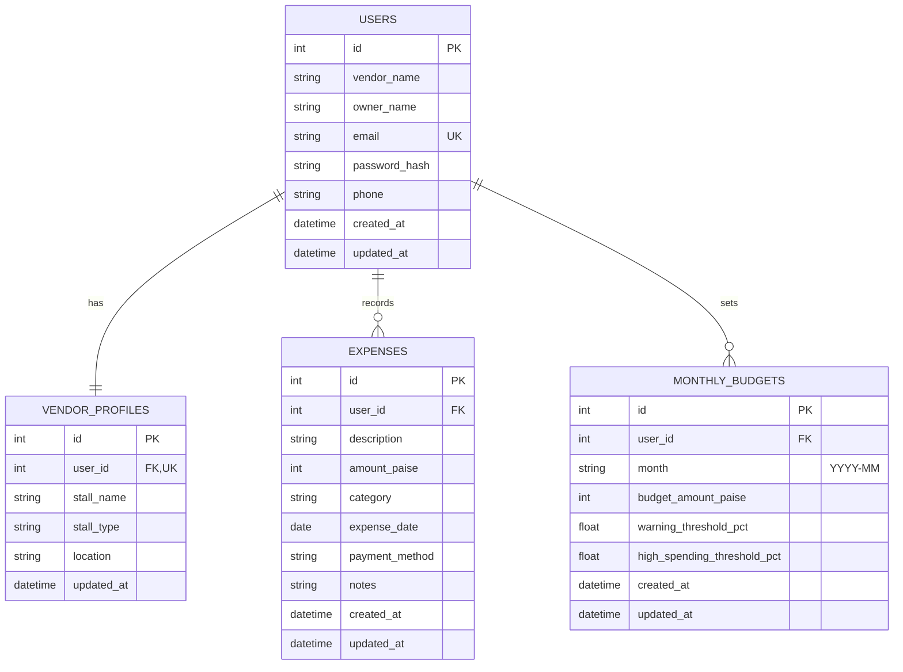

# StreetLedger — Multi-Vendor Street Food Expense & Budget Platform

A general-purpose expense tracking, monthly budgeting, and financial analytics platform designed specifically for street food vendors operating near college campuses, food streets, and urban markets.

StreetLedger is built from the ground up as a **multi-vendor platform**. It allows any street food vendor to register their stall, manage day-to-day culinary expenses, visualize category spending trends, track monthly budget utilization with real-time threshold warnings, and safeguard their financial records with robust data isolation.

---

## 1. Overview & Target Audience

### Who Is StreetLedger For?
- **Campus Street Food Vendors**: Chaat stalls, momo corners, tea & snack points, sandwich & roll carts, dosa corners, and juice bars operating around colleges and universities.
- **Micro Food Businesses**: Solo and small-team vendors who manage fluctuating daily ingredient costs, LPG cylinder refills, packaging materials, and seasonal vegetable prices.
- **Vendors Seeking Clear Accounting**: Food stall owners who need immediate answers to *"How much did I spend on cooking oil this month?"* and *"Am I close to exceeding my monthly spending budget?"*

### Core Value Proposition
- **Multi-Vendor Architecture**: Not hardcoded for any single shop. Independent vendor accounts with strict backend data isolation.
- **Tailored Food Categories**: Pre-tuned spending categories reflecting the actual reality of street food supply chains.
- **Proactive Budget Guardrails**: Instant alerts when spending reaches 80%, 90%, and 100% of the vendor's chosen monthly budget.
- **Zero Payment Clutter**: Focused entirely on operational expense tracking, budgeting, and spending analytics without complex or unnecessary payment integrations.

---

## 2. Compulsory Technology Stack

| Layer | Technology | Description |
| :--- | :--- | :--- |
| **Frontend** | React 18+ with Vite | Fast single-page application with modern component architecture |
| **Styling** | Tailwind CSS | Sleek, mobile-first, responsive interface with clean typography & dark/light accents |
| **Backend** | Python 3.12+ with FastAPI | High-performance asynchronous REST API framework |
| **Database** | SQLite 3 | Relational database engine with foreign key constraints and integer paise precision |
| **Charts** | Recharts | Responsive SVG charts (Pie / Donut charts and Bar charts) for category analytics |
| **Client API** | Axios / Fetch API | Standardized API client with JWT bearer authentication interceptors |

---

## 3. Four Mandatory Features

### Feature 1: Record Daily Expenses & Categorize Spending
- Authenticated vendors can create, view, filter, edit, and delete their own daily expense records.
- Monetary values are accurately captured in **paise** (1 INR = 100 paise) to eliminate floating-point rounding errors.
- Pre-configured food vendor categories:
  1. Ingredients and raw materials
  2. Vegetables and fruits
  3. Cooking oil and spices
  4. LPG and fuel
  5. Packaging materials
  6. Transportation
  7. Stall rent and maintenance
  8. Cleaning supplies
  9. Equipment and repairs
  10. Miscellaneous
- Every expense record includes: `description`, `amount`, `category`, `expense_date`, optional `payment_method` (Cash, UPI, Net Banking), and optional `notes`.

### Feature 2: View Category-Wise Spending Charts
- Powered by **Recharts** interactive data visualizations.
- Dynamic **Donut/Pie Chart** showing percentage share of each category in the selected month.
- **Bar Chart** showing exact spending comparison across categories.
- Month selector (`YYYY-MM`) allowing vendors to examine historical months or current spending.
- Real-time updates: whenever an expense is created, updated, or deleted, charts recalculate immediately.
- Zero data contamination across vendors.

### Feature 3: Track Remaining Monthly Budget
- Vendors configure their customized spending budget per month.
- Automatic computation:
  $$\text{Remaining Budget} = \text{Monthly Budget} - \text{Total Expenses for Selected Month}$$
- Displays:
  - Total Monthly Budget
  - Total Spent So Far
  - Remaining Balance (or Overspent Amount)
  - Utilization Percentage
- Visual state changes (Normal, Warning, Overspent) to provide instant financial awareness.

### Feature 4: Real-Time Alerts on Spending Limits
- Vendors can customize warning thresholds (default: **80%**) and high-spending thresholds (default: **90%**).
- Threshold states:
  - 🟢 **Safe Zone (< 80%)**: Spending is well within limits.
  - 🟡 **Warning Alert (80% - 89.9%)**: Approaching the monthly budget limit.
  - 🟠 **High Spending Alert (90% - 99.9%)**: Critical threshold reached; caution advised on non-essential restocks.
  - 🔴 **Budget Exceeded (≥ 100%)**: Clear banner alert notifying overspending with exact excess amount.
- Recalculated dynamically upon any expense addition, edit, deletion, or budget adjustment.

---

## 4. Security & Multi-Vendor Data Isolation

1. **Backend-Enforced Isolation**:
   - Every protected API route requires a valid **JWT Bearer Token** in the `Authorization` header.
   - The vendor's identity (`user_id`) is extracted strictly from the verified JWT payload on the backend.
   - Route handlers **never** trust client-supplied vendor IDs for data ownership.
   - Any query to `expenses` or `monthly_budgets` automatically includes `WHERE user_id = current_user.id`.
   - Accessing or modifying another vendor's expense returns `404 Not Found` or `403 Forbidden`.

2. **Password Security**:
   - Passwords are securely hashed using `bcrypt` / `passlib` with cryptographic salt rounds.
   - Plaintext passwords are never logged, stored, or returned.

3. **Form Validation & Protection**:
   - Strict validation on user registration, login, and budget threshold boundaries (e.g., warning threshold < high-spending threshold).

---

## 5. Database Schema & Architecture

SQLite relational database with foreign key support enabled (`PRAGMA foreign_keys = ON`):



### Table Specifications & Constraints
- `users`: Stores core credentials. `email` is enforced with a unique constraint.
- `vendor_profiles`: Stores stall metadata and food category. `user_id` has a unique foreign key constraint to `users(id)`.
- `expenses`: Stores individual expense records. `amount_paise` is stored as an integer (e.g. ₹250.00 = 25000 paise).
- `monthly_budgets`: Enforces `UNIQUE(user_id, month)` so that each vendor has at most one budget configuration per calendar month.

---

## 6. Complete API Endpoints Specification

### Authentication & Account (`/api/auth`)

| Method | Endpoint | Auth | Request Body | Description |
| :--- | :--- | :--- | :--- | :--- |
| `POST` | `/api/auth/register` | None | `{ vendor_name, owner_name, email, password, confirm_password, phone?, stall_type? }` | Register a new vendor and automatically create their stall profile |
| `POST` | `/api/auth/login` | None | `{ email, password }` | Authenticate vendor credentials; returns JWT `access_token` and vendor details |
| `GET` | `/api/auth/me` | Bearer | None | Fetch current authenticated vendor information |
| `POST` | `/api/auth/logout` | Bearer | None | Client-side token invalidation confirmation |

### Vendor Profile & Stall Settings (`/api/vendor`)

| Method | Endpoint | Auth | Request Body | Description |
| :--- | :--- | :--- | :--- | :--- |
| `GET` | `/api/vendor/profile` | Bearer | None | Retrieve authenticated vendor's stall details |
| `PUT` | `/api/vendor/profile` | Bearer | `{ stall_name, owner_name, stall_type, location, phone }` | Update vendor profile and stall details |

### Expenses Management (`/api/expenses`)

| Method | Endpoint | Auth | Request / Query | Description |
| :--- | :--- | :--- | :--- | :--- |
| `GET` | `/api/expenses` | Bearer | Query: `month` (YYYY-MM), `category`, `search`, `limit`, `offset` | List vendor's expenses with filtering |
| `POST` | `/api/expenses` | Bearer | `{ description, amount, category, expense_date, payment_method?, notes? }` | Create a new expense entry (amount in INR or paise) |
| `GET` | `/api/expenses/{id}` | Bearer | Path: `id` | Retrieve single expense by ID (enforces vendor ownership) |
| `PUT` | `/api/expenses/{id}` | Bearer | `{ description, amount, category, expense_date, payment_method?, notes? }` | Update expense by ID (enforces vendor ownership) |
| `DELETE` | `/api/expenses/{id}` | Bearer | Path: `id` | Delete expense by ID (enforces vendor ownership) |
| `GET` | `/api/expenses/categories` | None | None | Retrieve standard food vendor spending categories |

### Monthly Budget & Alerts (`/api/budget`)

| Method | Endpoint | Auth | Request / Query | Description |
| :--- | :--- | :--- | :--- | :--- |
| `GET` | `/api/budget` | Bearer | Query: `month` (YYYY-MM, defaults to current month) | Fetch monthly budget, total expenses, remaining budget, utilization %, and active alert status |
| `POST` | `/api/budget` | Bearer | `{ month, budget_amount, warning_threshold_pct?, high_spending_threshold_pct? }` | Set or update monthly budget and threshold levels |
| `GET` | `/api/budget/alerts` | Bearer | Query: `month` (YYYY-MM) | Retrieve active warning, high-spending, or overspent notifications |

### Spending Analytics (`/api/analytics`)

| Method | Endpoint | Auth | Request / Query | Description |
| :--- | :--- | :--- | :--- | :--- |
| `GET` | `/api/analytics/category-wise` | Bearer | Query: `month` (YYYY-MM) | Category breakdown: category name, total spent in INR/paise, percentage share, item count for Recharts |
| `GET` | `/api/analytics/monthly-summary` | Bearer | Query: `month` (YYYY-MM) | Summary comparison of budget vs spent, daily average spending, and top spending category |

---

## 7. Application Pages & Navigation Structure

1. **Registration (`/register`)**: Account creation with vendor name, owner name, email, phone, stall type, and password confirmation.
2. **Login (`/login`)**: Vendor sign-in with show/hide password toggle, clear error feedback, and redirect to dashboard.
3. **Dashboard (`/` or `/dashboard`)**: High-level executive overview featuring current month spending, budget progress gauge, active alerts, quick expense logger, and category chart preview.
4. **Expense Management (`/expenses`)**: Full CRUD table and card view of daily expenses, date picker, category dropdown, search, and pagination.
5. **Spending Analytics (`/analytics`)**: Detailed Recharts interactive donut/pie charts and bar charts with category percentage breakdowns and monthly trends.
6. **Monthly Budget Settings (`/budget`)**: Budget planner interface to configure monthly limits and customize 80%/90% alert thresholds.
7. **Vendor Profile & Stall Settings (`/profile`)**: Update stall details, food category, contact information, and location.
8. **Logout Flow**: Seamless logout button in navigation that wipes authenticated token state and redirects to `/login`.

---

## 8. Environment Variables & Configuration

Create a `.env` file in the `backend/` directory:

```env
# Server Configuration
PORT=8000
HOST=0.0.0.0
ENVIRONMENT=development

# JWT & Security
SECRET_KEY=streetledger_secure_super_secret_jwt_key_2026_change_in_production
ALGORITHM=HS256
ACCESS_TOKEN_EXPIRE_MINUTES=1440

# Database Configuration
DATABASE_URL=sqlite:///./streetledger.db

# CORS Settings (frontend origins)
CORS_ORIGINS=http://localhost:5173,http://localhost:3000,http://127.0.0.1:5173
```

In the `frontend/` directory (optional `.env`):

```env
VITE_API_BASE_URL=http://localhost:8000
```

---

## 9. Installation & Startup Instructions

### Prerequisites
- Python 3.10+ (Python 3.12 recommended)
- Node.js 18+ & npm

### Backend Setup
1. Open a terminal and navigate to the backend folder:
   ```bash
   cd backend
   ```
2. Install Python dependencies:
   ```bash
   pip install -r requirements.txt
   ```
3. Initialize the database and start the FastAPI dev server:
   ```bash
   uvicorn main:app --reload --port 8000
   ```
   *The backend will be running at `http://localhost:8000` with Swagger documentation at `http://localhost:8000/docs`.*

### Frontend Setup
1. Open a second terminal and navigate to the frontend folder:
   ```bash
   cd frontend
   ```
2. Install Node dependencies:
   ```bash
   npm install
   ```
3. Start the Vite development server:
   ```bash
   npm run dev
   ```
   *The frontend will be running at `http://localhost:5173`.*

---

## 10. Demo Accounts & Testing Guide

For quick evaluation, seed test vendors are provided:

| Account | Email | Password | Stall Type |
| :--- | :--- | :--- | :--- |
| **Vendor 1 (Chaat Corner)** | `sharma.chaat@example.com` | `Vendor@123` | Chaat & Street Snacks |
| **Vendor 2 (South Indian)** | `annapurna.dosa@example.com` | `Vendor@123` | South Indian Tiffin |

### Testing Cross-Vendor Isolation
1. Log in as `sharma.chaat@example.com`. Record an expense of ₹500 for "Cooking oil and spices".
2. Note the expense ID (e.g., ID: `1`).
3. Log out and log in as `annapurna.dosa@example.com`.
4. Inspect the dashboard and expense list: Expense `1` is completely invisible.
5. Attempting to fetch or modify `/api/expenses/1` as Annapurna returns `404 Not Found`.

---

## 11. Known Limitations & Design Clarifications

- **Operational Focus**: StreetLedger is focused purely on expense and budget management. It deliberately omits payment gateway processing and QR-based collection to keep accounting lightweight and direct.
- **Single-Device Offline Caching**: In the current version, database transactions are executed against the centralized SQLite store via the FastAPI backend. Full offline PWA sync is queued for subsequent releases.
